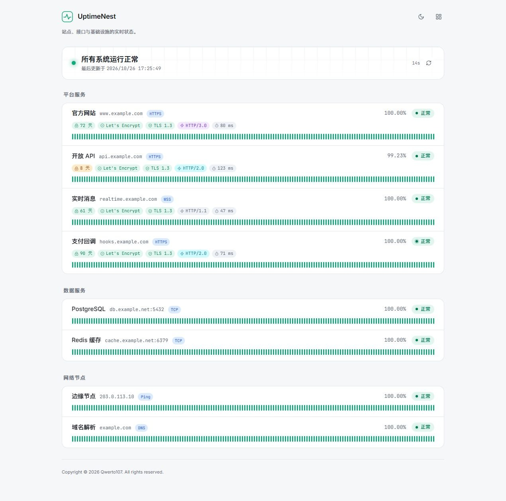
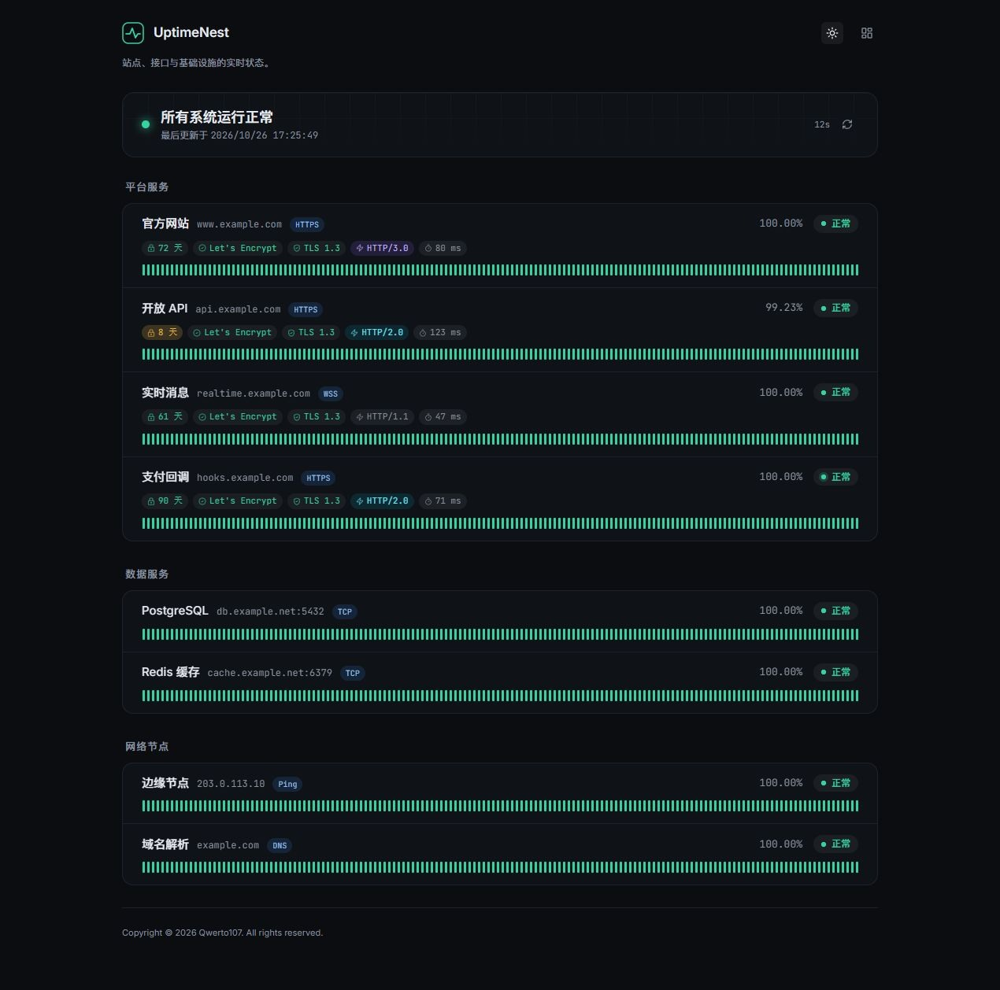
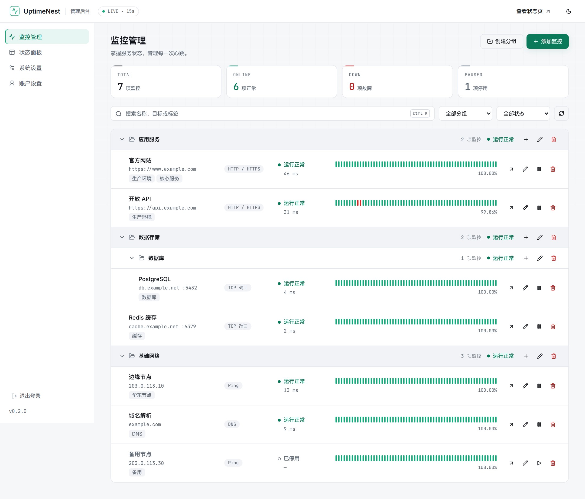
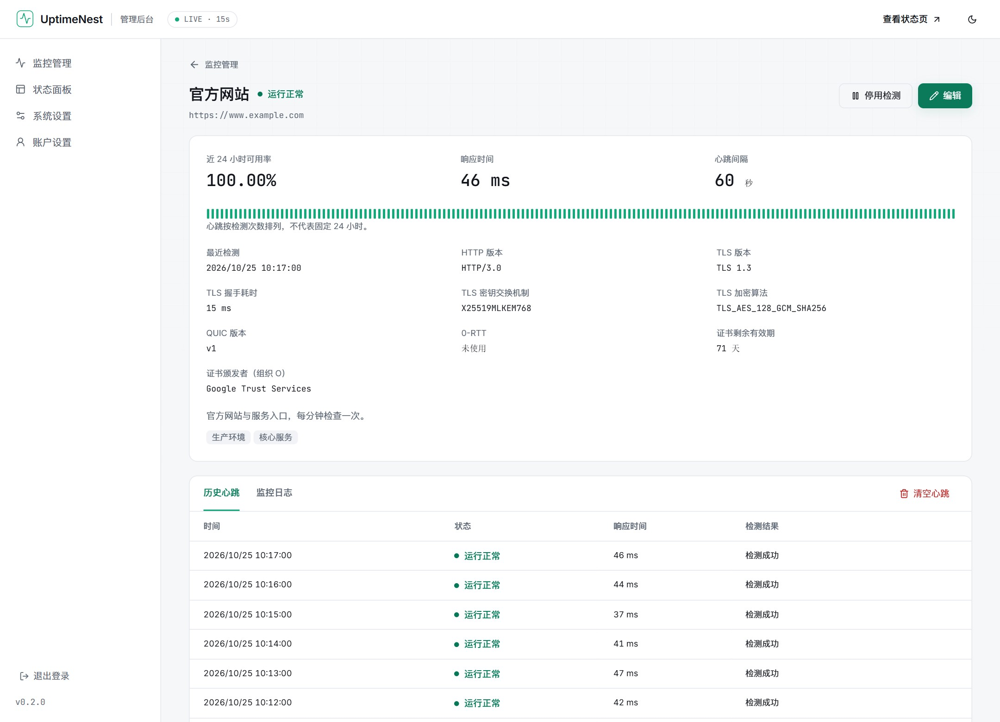
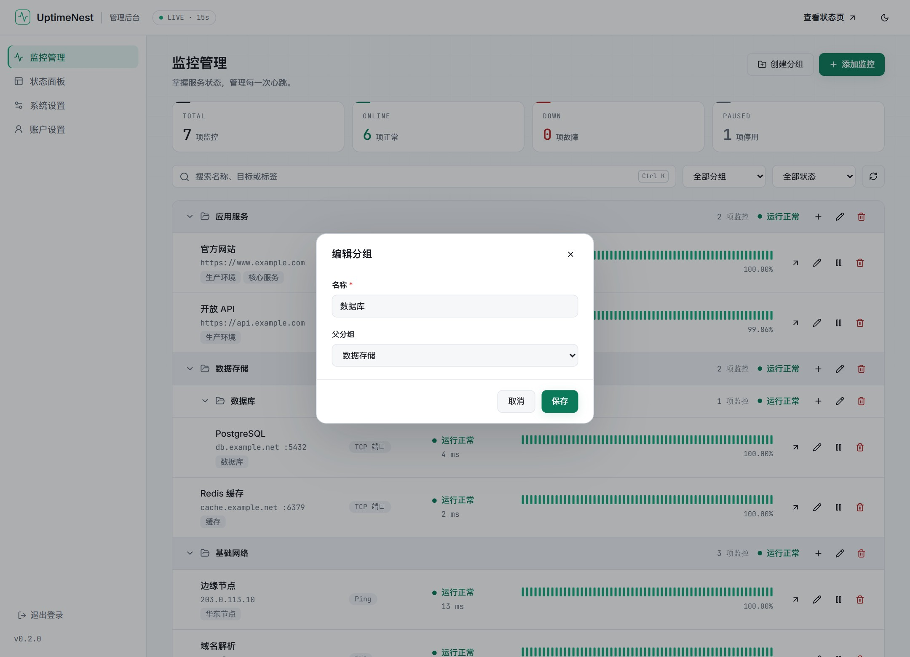
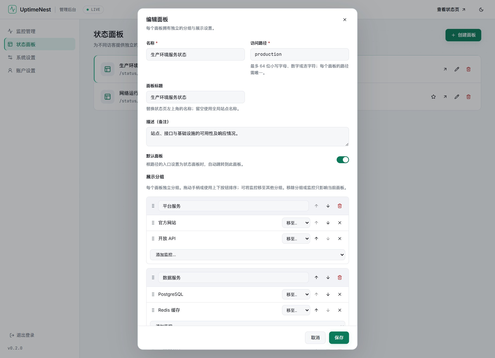
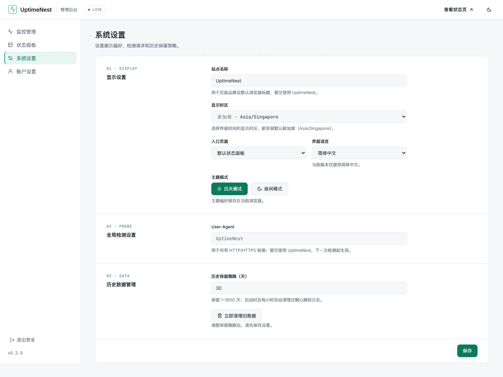

<div align="center">


# UptimeNest

可自托管的服务与网络监控系统。集中检查站点、接口、端口与网络节点，通过独立状态页展示服务可用性。

[快速部署](#快速部署) · [文档中心](docs/README.md) · [API 参考](docs/api.md) · [下载版本](https://github.com/Qwerto107/UptimeNest/releases)

**Go + Vue** · **SQLite / PostgreSQL** · **HTTP(S) / TCP / Ping / DNS**

一个容器或一个程序，同时提供状态页、管理后台与 API。

</div>

---

## 界面一览

状态页按面板独立分组，展示近期心跳、可用率与连接信息，支持浅色和深色主题。



<details>
<summary><strong>查看更多：深色状态页、监控详情、分组、面板与系统设置</strong></summary>













截图来自当前界面，使用独立演示数据，域名、地址和统计仅作展示，不包含真实凭据。正式版功能以对应 [更新记录](docs/changelog.md) 为准。

</details>

## 功能

| 能力 | 使用方式 |
| --- | --- |
| 常规监控 | HTTP/HTTPS、TCP 端口、Ping 和 DNS；自定义间隔、超时、重试及反转模式 |
| HTTP 请求 | HTTP/3 优先回退或仅 HTTP/3，设置方法、有效状态码、重定向、请求体与请求头 |
| 请求验证 | Basic、OAuth2 客户端凭据和 PEM 格式 mTLS |
| 连接详情 | TLS/HTTP 版本、握手耗时、证书剩余有效期及签发者组织；展开查看密钥交换与加密套件，HTTP/3 额外显示 QUIC 版本和实际 0-RTT 使用状态 |
| 后台分组 | 父子树形管理、展开折叠、父组汇总子树状态、调整监控归属 |
| 状态面板 | 多独立路径、默认面板、自定义标题、独立展示分组、实时拖拽及按钮排序、按项隐藏地址 |
| 历史数据 | 查看心跳及日志、按项独立清空、保留期限与自动／手动过期清理 |
| 系统设置 | 站点名称、列表选择时区、入口页面、全局 HTTP User-Agent、浅色／深色主题 |
| 账户管理 | 首次设置管理员密码、登录、修改密码及会话撤销 |
| 数据库 | SQLite 或 PostgreSQL 独立运行，启动时执行版本化迁移 |

后台分组与面板展示分组分别管理，详细行为见 [使用指南](docs/usage.md)。

新安装默认使用新加坡时区、30 天历史保留期限及 `UptimeNest` 请求 User-Agent；升级保留已保存的设置。

## 快速部署

推荐使用统一镜像，一个容器提供状态页、管理后台与 API。安装 Docker 与 Compose 后，创建运行目录并下载配置，无需克隆源码。

以下权限命令用于 Linux 新建专用目录；已有目录或 Docker Desktop 的权限设置见 [部署指南](docs/deployment.md)。

```sh
mkdir -p uptimenest/data
sudo chown 65532:65532 uptimenest/data
sudo chmod 700 uptimenest/data
cd uptimenest
curl -fL https://raw.githubusercontent.com/Qwerto107/UptimeNest/main/docker-compose.yml -o docker-compose.yml
```

```sh
docker compose up -d --pull always
```

1. 打开 <http://127.0.0.1:8090/admin>，首次访问时设置管理员密码。
2. 创建监控项，按需设置后台分组。
3. 创建状态面板，添加展示分组和监控项，并将需要的面板设为默认。

没有通用初始密码，无须通过环境变量设置密码。数据保存在 `./data`，端口默认仅本机可访问。镜像版本和端口直接在 `docker-compose.yml` 中修改。

Windows、外部数据库、HTTPS 和升级步骤见 [部署指南](docs/deployment.md)。直接运行程序见 [二进制部署](docs/binary.md)，安装包从 [Releases](https://github.com/Qwerto107/UptimeNest/releases) 下载。

## 支持范围

- 前后台心跳条使用固定细条和间距，按容器宽度显示最新一段检测记录；可用率与平均响应时间按近 24 小时计算，不代表心跳条覆盖的时间。
- HTTP/3 需要 HTTPS 及 UDP 连通；自动模式仅在 QUIC 连接建立失败时回退，不重发已经发出的请求。
- Ping 使用系统命令。容器已提供 Ping，直接运行程序时需要系统安装 `ping` 并允许 ICMP。
- 面板为公开展示页面；地址可逐项隐藏，完整请求配置和验证凭据仅管理员可见。
- 当前按单应用实例运行，SQLite 使用本机磁盘。界面仅提供简体中文，支持手动切换浅色／深色主题。
- 当前不包含通知推送、通知管理或第三方通知渠道接入。

## 文档导航

| 内容 | 文档 |
| --- | --- |
| 监控、分组、面板与系统设置 | [使用指南](docs/usage.md) |
| Docker、环境变量、反向代理与升级 | [部署指南](docs/deployment.md) |
| Linux、Windows、macOS 单文件运行 | [二进制部署](docs/binary.md) |
| API 请求、参数与返回值 | [API 参考](docs/api.md) |
| 本地开发、构建与内部实现 | [开发指南](docs/development.md) |
| 二进制、多架构镜像与自动 Release | [发布流程](docs/releasing.md) |
| 版本变化 | [更新记录](docs/changelog.md) |
