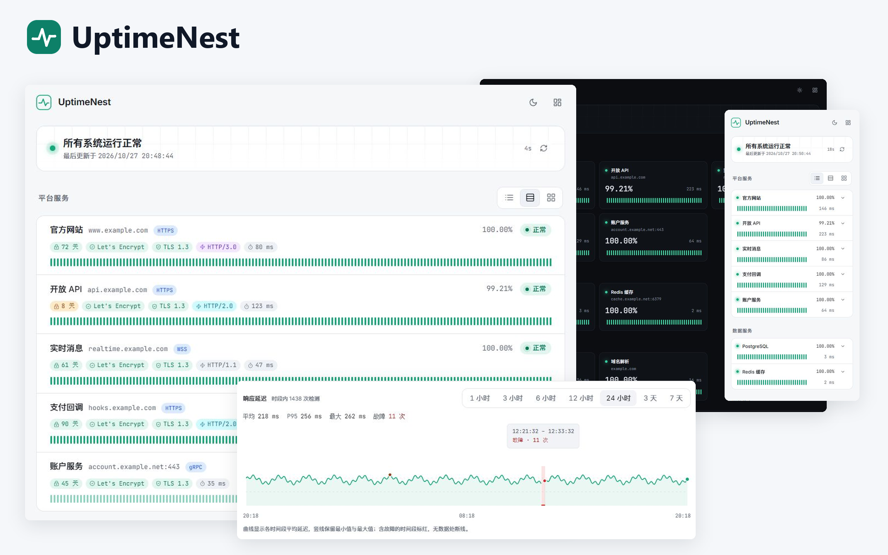

<div align="center">


# UptimeNest

可自托管的服务与网络监控系统。集中检查站点、接口、端口与网络节点，通过独立状态页展示服务可用性。

[快速部署](#快速部署) · [文档中心](docs/README.md) · [API 参考](docs/api.md) · [下载版本](https://github.com/Qwerto107/UptimeNest/releases)

**Go + Vue** · **SQLite / PostgreSQL** · **HTTP(S) / WebSocket / gRPC / TCP / Ping / DNS**

一个容器或一个程序，同时提供状态页、管理后台与 API。

</div>

---

## 界面一览

状态页支持紧凑行、详细行和卡片，展示近期心跳、可用率与连接信息。后台支持时间范围延迟图表，兼容桌面与手机，提供浅色和深色主题。



*由独立演示环境的真实截图排版合成，界面内容未经重绘。*

[查看实际界面截图](docs/screenshots.md)：状态页、监控管理、协议配置、分组、面板和系统设置。

## 功能

| 能力 | 使用方式 |
| --- | --- |
| 常规监控 | HTTP/HTTPS、WebSocket（WS/WSS）、gRPC、TCP 端口、Ping 和 DNS；Ping 最小间隔 1 秒，支持超时、重试及反转模式 |
| HTTP 请求 | 手动 HTTP/1.1、HTTP/2、HTTP/3 或两种自动协商；指定连接 IP，配置方法、状态码、重定向、请求体与请求头 |
| WebSocket | WS/WSS 握手或 Ping/Pong 检测，支持 Origin、子协议、请求头及指定连接 IP |
| gRPC | 标准健康检查，支持 TLS／明文、服务名称、自定义 Metadata 和附加 CA；TLS 模式接入证书信息与告警 |
| 请求验证 | Basic、OAuth2 客户端凭据和 PEM 格式 mTLS |
| 连接详情 | TLS/HTTP 版本、握手耗时、证书剩余有效期及签发者组织；展开查看密钥交换与加密套件，HTTP/3 额外显示 QUIC 版本和实际 0-RTT 使用状态 |
| 监控操作 | 复制现有配置创建独立监控，从分组加号直接创建组内监控 |
| 后台分组 | 父子树形管理、展开折叠、父组汇总子树状态、调整监控归属 |
| 状态面板 | 紧凑行、详细行和卡片；管理员设置默认视图，访客临时切换；多独立路径、自定义标题、独立展示分组、拖拽排序及按项隐藏地址 |
| 延迟图表 | 后台支持 1、3、6、12、24 小时及 3、7 天范围，展示平均值、P95、峰值和故障记录 |
| 历史数据 | 查看心跳及日志、按项独立清空、保留期限与自动／手动过期清理 |
| 告警通知 | 每个监控单独开启服务异常、证书临期与过期告警；邮件、Webhook、飞书卡片、钉钉和 Telegram；独立服务／证书模板、英文变量、预览与测试、恢复与重复提醒及发送记录 |
| 系统设置 | 站点名称、时区、界面语言、入口、默认视图、User-Agent、TLS 握手提醒、证书临期高亮和浅色／深色主题；证书高亮天数可按监控项覆盖 |
| 账户管理 | 首次设置管理员密码、登录、修改密码及会话撤销 |
| 数据库 | SQLite 或 PostgreSQL 独立运行，启动时执行版本化迁移 |

后台分组与面板展示分组分别管理，详细行为见 [使用指南](docs/usage.md)。

新安装默认使用新加坡时区、30 天历史保留期限及 `UptimeNest` 请求 User-Agent；升级保留已保存的设置。

## 快速部署

推荐使用统一镜像，一个容器提供状态页、管理后台与 API。安装 Docker 与 Compose 后，创建运行目录并下载配置，无需克隆源码。

以下权限命令用于 Linux 新建专用目录；已有目录或 Docker Desktop 的权限设置见 [部署指南](docs/deployment.md)。

```sh
mkdir -p uptimenest/data
sudo chown 65532:65532 uptimenest/data
sudo chmod 700 uptimenest/data
cd uptimenest
curl -fL https://raw.githubusercontent.com/Qwerto107/UptimeNest/main/docker-compose.yml -o docker-compose.yml
```

```sh
docker compose up -d --pull always
```

1. 运行 `docker compose logs uptimenest`，复制本次启动日志中的 `setup_token`。
2. 打开 <http://127.0.0.1:8090/admin>，填写初始化令牌并设置管理员密码。
3. 创建监控项，按需设置后台分组。
4. 创建状态面板，添加展示分组和监控项，并将需要的面板设为默认。

没有通用初始密码，无须通过环境变量设置密码。数据保存在 `./data`，端口默认仅本机可访问。镜像版本和端口直接在 `docker-compose.yml` 中修改。

初始化令牌仅在尚未创建管理员时输出，重启后更新，创建管理员后失效。已有账户升级后照常登录。

程序自动生成 `data/secret.key` 加密配置，SQLite 和 PostgreSQL 部署都需要持久化该文件。恢复数据库时必须使用原密钥，备份说明见 [部署指南](docs/deployment.md#配置加密与密钥)。

Windows、外部数据库、HTTPS 和升级步骤见 [部署指南](docs/deployment.md)。直接运行程序见 [二进制部署](docs/binary.md)，安装包从 [Releases](https://github.com/Qwerto107/UptimeNest/releases) 下载。

## 支持范围

- 前后台心跳条按容器宽度显示最近的检测记录。汇总可用率与平均响应时间按近 24 小时计算；后台延迟图表按所选时间范围统计，受历史保留设置限制。
- HTTP/3 需要 HTTPS 及 UDP 连通；自动模式仅在 QUIC 连接建立失败时回退，不重发已经发出的请求。
- WebSocket 握手与 Ping/Pong 用于检查协议连接，响应延迟包含连接及所选检测步骤；WSS 始终校验证书。
- Ping 使用原生 ICMP，支持 IPv4 和 IPv6，不依赖系统 `ping`。Linux 需允许应用所属组创建 ICMP datagram socket，Compose 已配置。
- 面板为公开展示页面；地址可逐项隐藏。完整请求配置由管理员按需读取，保存的凭据不回显，支持替换和清除。
- 当前按单应用实例运行，SQLite 使用本机磁盘。界面支持英语与简体中文，新安装默认英语，支持手动切换浅色／深色主题。
- 告警默认关闭，先配置通知渠道，再在每个监控的“告警”页签中关联。通知行为及模板变量见 [告警通知](docs/usage.md#告警通知)。

## 文档导航

| 内容 | 文档 |
| --- | --- |
| 监控、分组、面板与系统设置 | [使用指南](docs/usage.md) |
| Docker、环境变量、反向代理与升级 | [部署指南](docs/deployment.md) |
| Linux、Windows、macOS 单文件运行 | [二进制部署](docs/binary.md) |
| API 请求、参数与返回值 | [API 参考](docs/api.md) |
| 本地开发、构建与内部实现 | [开发指南](docs/development.md) |
| 二进制、多架构镜像与自动 Release | [发布流程](docs/releasing.md) |
| 版本变化 | [更新记录](docs/changelog.md) |
