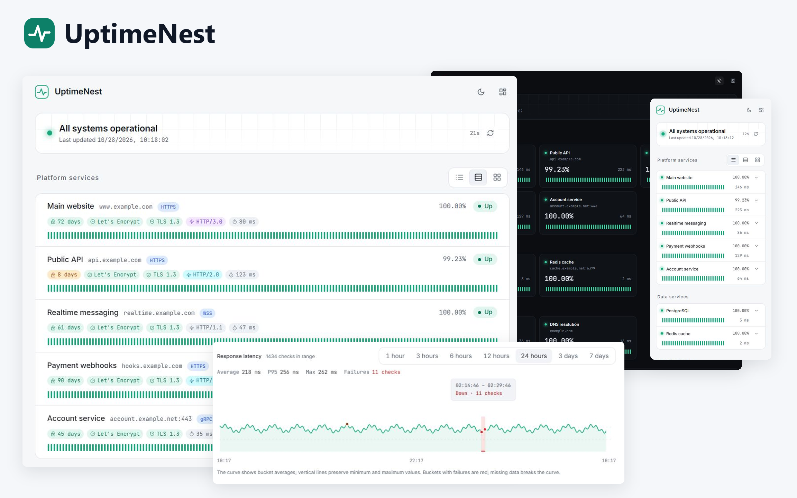

<div align="center">


# UptimeNest

[简体中文](README.md) · English

A self-hosted service and network monitor. Check websites, APIs, ports, and network nodes, and share availability through independent status pages.

[Quick start](#quick-start) · [Documentation](docs/README_en.md) · [API reference](docs/api_en.md) · [Downloads](https://github.com/Qwerto107/UptimeNest/releases)

**Go + Vue** · **SQLite / PostgreSQL** · **HTTP(S) / WebSocket / gRPC / TCP / Ping / DNS**

One container or executable serves the status pages, admin interface, and API.

</div>

---

## Interface preview

Status pages support compact rows, detailed rows, and cards, with recent heartbeats, availability, and connection details. The admin interface includes latency charts with selectable time ranges. Desktop and mobile layouts support light and dark themes.



*Composed from actual screenshots of an isolated demo. The interface content has not been redrawn.*

[View interface screenshots](docs/screenshots_en.md): status pages, monitor management, protocol settings, groups, panels, and system settings.

## Features

| Feature | Capabilities |
| --- | --- |
| Monitor types | HTTP/HTTPS, WebSocket (WS/WSS), gRPC, TCP ports, Ping, and DNS; Ping supports intervals as short as 1 second, with timeouts, retries, and inverted status |
| HTTP requests | Explicit HTTP/1.1, HTTP/2, or HTTP/3, or two automatic negotiation modes; connection IP override, methods, accepted status codes, redirects, bodies, and headers |
| WebSocket | WS/WSS handshake or Ping/Pong checks, with Origin, subprotocols, headers, and connection IP override |
| gRPC | Standard health checks over TLS or plaintext, with service names, metadata, and additional CA certificates; TLS checks include certificate details and alerts |
| Authentication | Basic authentication, OAuth2 client credentials, and PEM-based mTLS |
| Connection details | TLS/HTTP versions, handshake time, certificate lifetime and issuer organization; expanded key exchange and cipher details; HTTP/3 also shows QUIC version and actual 0-RTT use |
| Monitor actions | Duplicate an existing configuration or create a monitor directly in a group |
| Admin groups | Parent/child hierarchy, expand and collapse, subtree status summaries, and monitor assignment |
| Status panels | Compact rows, detailed rows, and cards; administrator-defined default view and temporary visitor switching; independent paths, titles, display groups, drag sorting, and optional address hiding |
| Latency charts | 1-, 3-, 6-, 12-, and 24-hour, 3-day, and 7-day ranges, with averages, P95, peaks, and failure records |
| History | Heartbeat and log browsing, per-monitor clearing, retention, and automatic or manual cleanup |
| Notifications | Per-monitor service and certificate alerts through email, Webhook, Feishu, DingTalk, or Telegram; separate service/certificate templates, English variables, previews, test sends, recovery and repeat notifications, and delivery records |
| System settings | Site name, timezone, language, entry page, default status view, User-Agent, TLS handshake warnings, certificate highlighting, and light/dark theme; certificate highlighting can be overridden per monitor |
| Account management | Initial administrator password setup, login, password changes, and session revocation |
| Storage | SQLite or PostgreSQL, with versioned migrations on startup |

Admin groups and status-panel display groups are managed independently. See the [usage guide](docs/usage_en.md).

New installations use the Singapore timezone, a 30-day retention period, and the `UptimeNest` request User-Agent. Upgrades preserve saved settings.

## Quick start

The recommended deployment uses one container for the pages, admin interface, and API. Install Docker and Compose, create a deployment directory, and download the configuration. Cloning the repository is unnecessary.

The following permission commands apply to a new dedicated directory on Linux. For existing data or Docker Desktop, see the [deployment guide](docs/deployment_en.md).

```sh
mkdir -p uptimenest/data
sudo chown 65532:65532 uptimenest/data
sudo chmod 700 uptimenest/data
cd uptimenest
curl -fL https://raw.githubusercontent.com/Qwerto107/UptimeNest/main/docker-compose.yml -o docker-compose.yml
```

```sh
docker compose up -d --pull always
```

1. Run `docker compose logs uptimenest` and copy `setup_token` from the current startup log.
2. Open <http://127.0.0.1:8090/admin>, enter the setup token, and set an administrator password.
3. Create monitors and assign admin groups as needed.
4. Create a status panel, add display groups and monitors, and set the desired default panel.

There is no shared default password, and no password environment variable is required. Data is stored in `./data`; the port is bound to localhost by default. Change the image version and port directly in `docker-compose.yml`.

The setup token is printed only while no administrator exists. Restarting generates a new token; creating the administrator invalidates it. Existing installations log in normally after an upgrade.

The application generates `data/secret.key` to encrypt configuration. Persist this file for both SQLite and PostgreSQL deployments. Restoring a database requires its original key; see [configuration encryption and keys](docs/deployment_en.md#configuration-encryption-and-keys).

For Windows, external databases, HTTPS, and upgrades, see the [deployment guide](docs/deployment_en.md). To run an executable directly, see [binary deployment](docs/binary_en.md). Download packages from [Releases](https://github.com/Qwerto107/UptimeNest/releases).

## Scope and behavior

- Heartbeat strips display as many recent records as the container width permits. Availability and average latency use the last 24 hours. Admin latency charts use the selected time range, subject to retention.
- HTTP/3 requires HTTPS and UDP connectivity. Automatic mode falls back only when establishing the QUIC connection fails; it does not resend a request that has already been sent.
- WebSocket handshake and Ping/Pong checks verify the protocol connection. Latency includes connection establishment and the selected check. WSS always validates certificates.
- Ping uses native IPv4/IPv6 ICMP and does not require a system `ping` executable. Linux must permit the application's group to create ICMP datagram sockets; Compose already configures this.
- Status panels are public. Addresses can be hidden per monitor. Administrators load complete request configuration on demand; stored secrets are not echoed back and can be replaced or explicitly cleared.
- The application currently targets a single application instance, with SQLite on a local disk. English and Simplified Chinese are supported; new installations default to English. Light/dark theme is selected manually.
- Alerts are disabled by default. Configure notification channels first, then associate them in each monitor's **Alerts** tab. See [notifications](docs/usage_en.md#notifications) for behavior and template variables.

## Documentation

| Topic | Document |
| --- | --- |
| Monitors, groups, panels, and system settings | [Usage guide](docs/usage_en.md) |
| Docker, environment variables, reverse proxies, and upgrades | [Deployment guide](docs/deployment_en.md) |
| Standalone executables for Linux, Windows, and macOS | [Binary deployment](docs/binary_en.md) |
| API requests, parameters, and responses | [API reference](docs/api_en.md) |
| Local development, builds, and internals | [Development guide](docs/development_en.md) |
| Binaries, multi-architecture images, and automated releases | [Release process](docs/releasing_en.md) |
| Version history | [Changelog](docs/changelog_en.md) |
