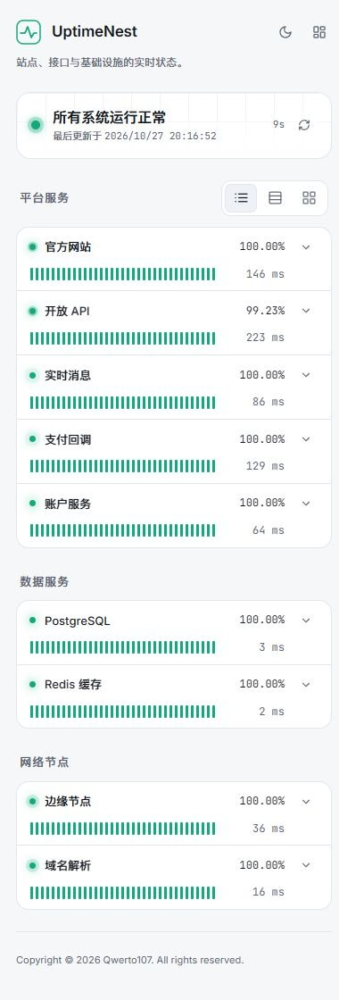
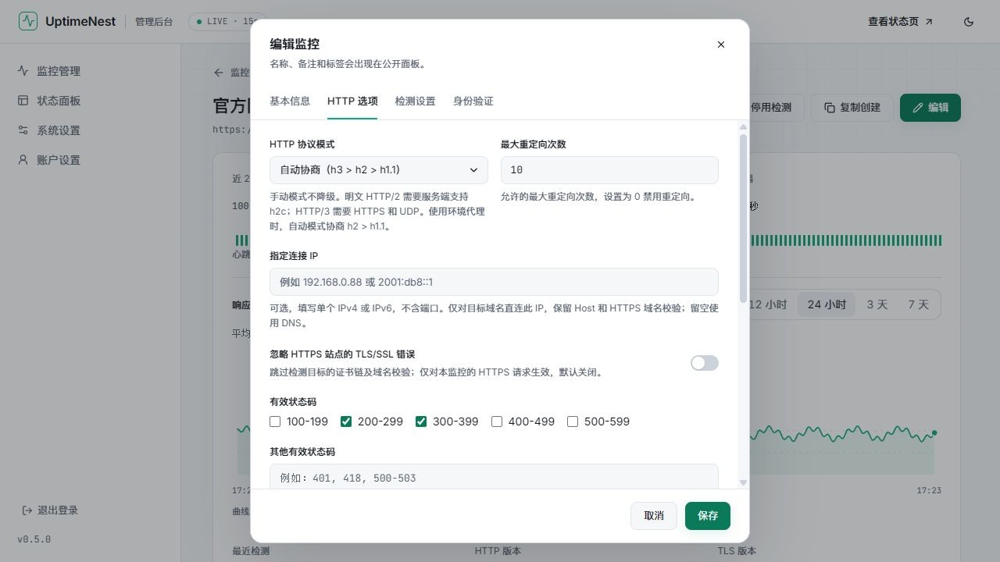
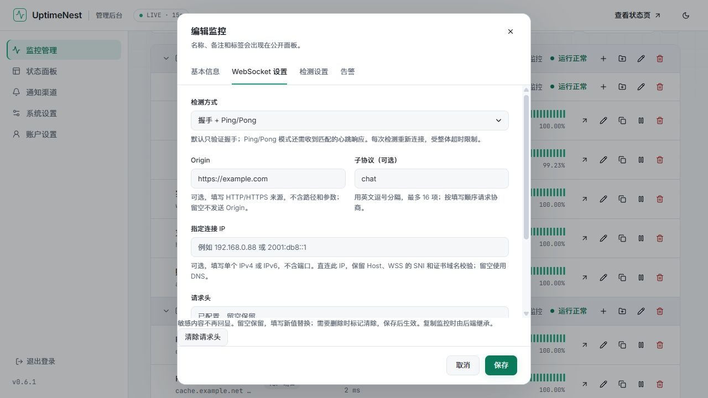

# 界面截图

简体中文 · [English](screenshots_en.md)

[项目首页](../README.md) · [文档中心](README.md) · [使用指南](usage.md)

截图来自独立演示环境，域名、地址和统计仅作展示，不包含真实凭据。配置说明见 [使用指南](usage.md)，版本变化见 [更新记录](changelog.md)。

[状态页](#状态页) · [监控管理与详情](#监控管理与详情) · [协议配置](#协议配置) · [分组与状态面板](#分组与状态面板) · [系统设置](#系统设置)

## 状态页

详细行展示服务分组、近期心跳、可用率和连接信息。

卡片视图突出可用率和响应时间，紧凑行适合在手机上查看多项服务。

<table>
  <tr><th width="75%">深色卡片视图</th><th width="25%">手机紧凑行视图</th></tr>
  <tr>
    <td valign="top"></td>
    <td valign="top"></td>
  </tr>
</table>

## 监控管理与详情

监控列表按分组展示运行状态，支持编辑、复制、启停和查看详情。

详情页展示可用率、响应时间和连接信息。延迟图表支持七档时间范围，并标记故障时段。

## 协议配置

HTTP 选项支持协议模式、指定连接 IP、重定向次数和有效状态码。

WebSocket 支持握手或 Ping/Pong 检测，可设置 Origin、子协议、连接 IP 和请求头。已保存的敏感配置留空保留，也可显式清除。

## 分组与状态面板

后台分组支持父子层级，可在监控列表中编辑名称和父级。

状态面板使用独立展示分组，支持调整监控顺序和跨组移动。

## 系统设置

系统设置包含语言、主题、默认视图、TLS 与证书提醒、历史保留和可信代理。

