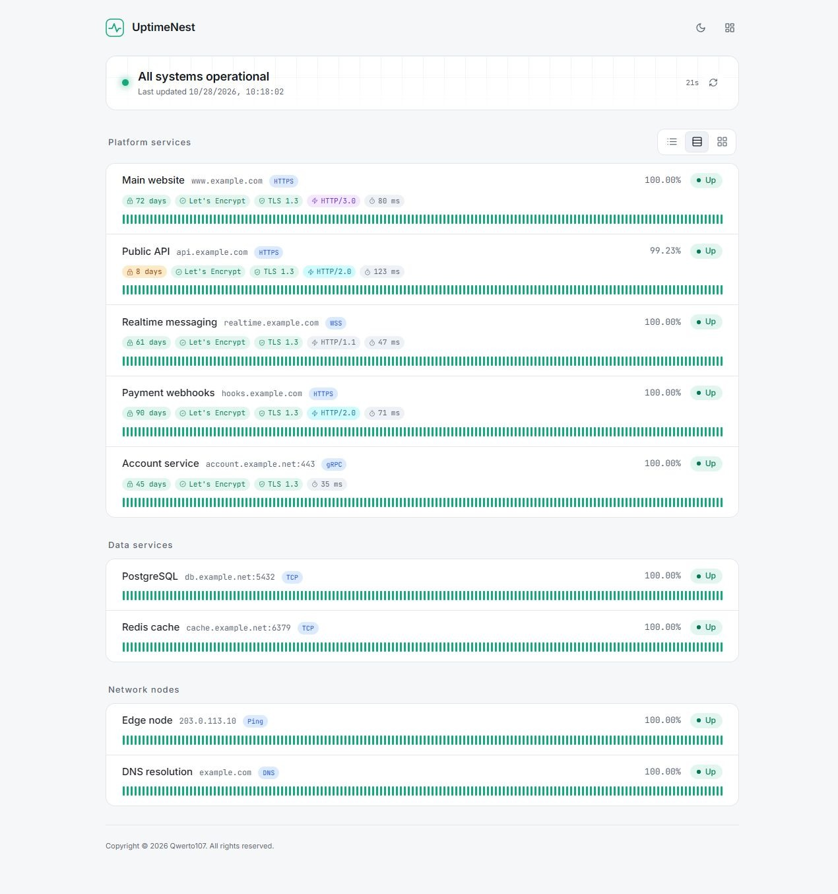
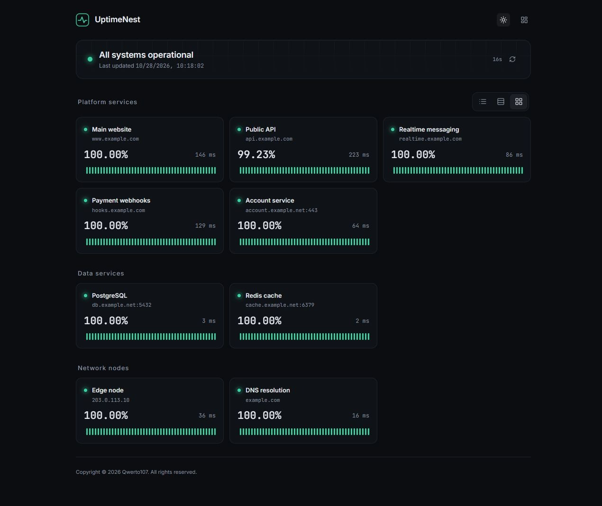
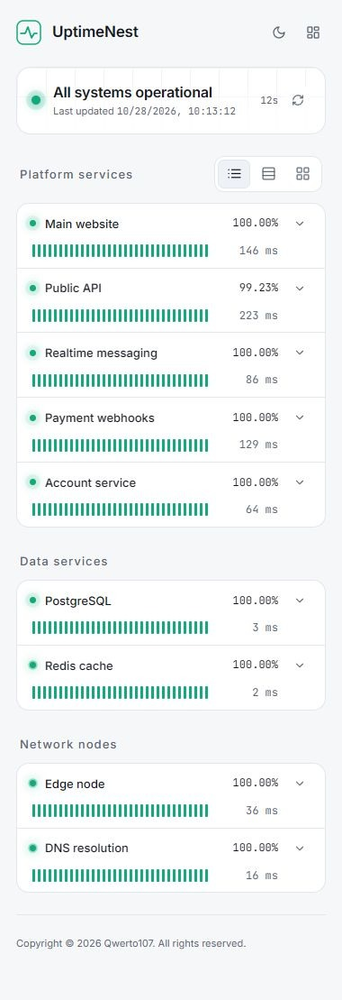
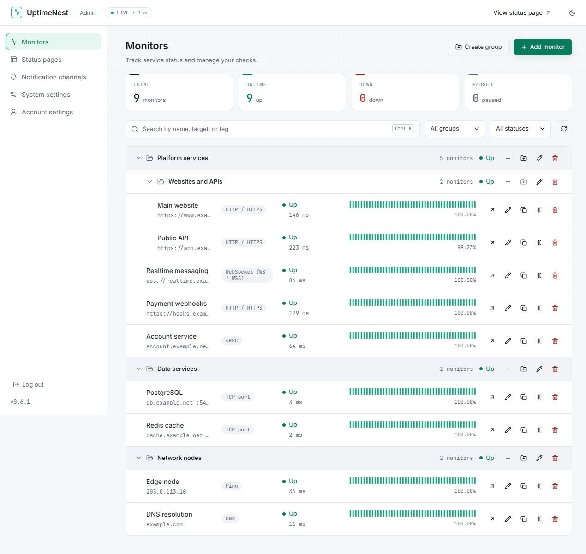
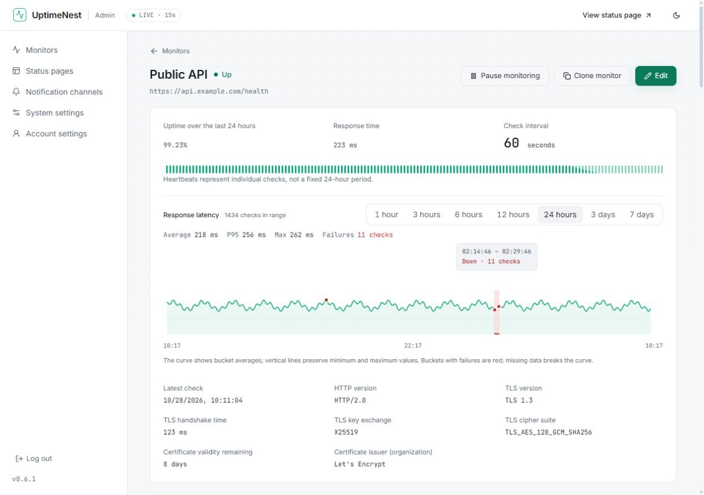
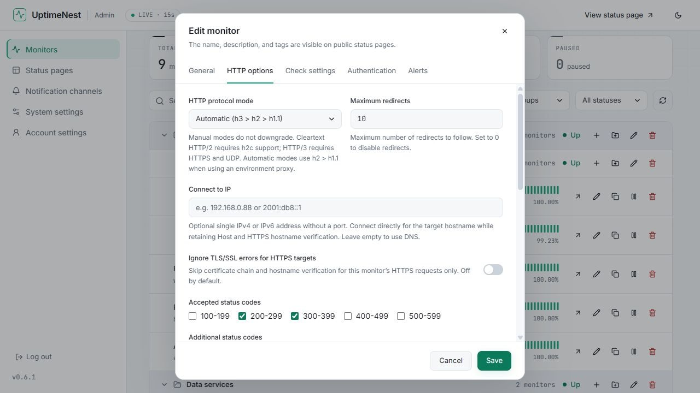
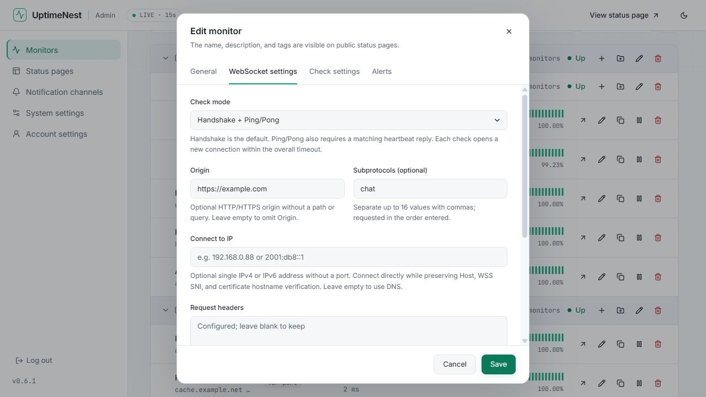
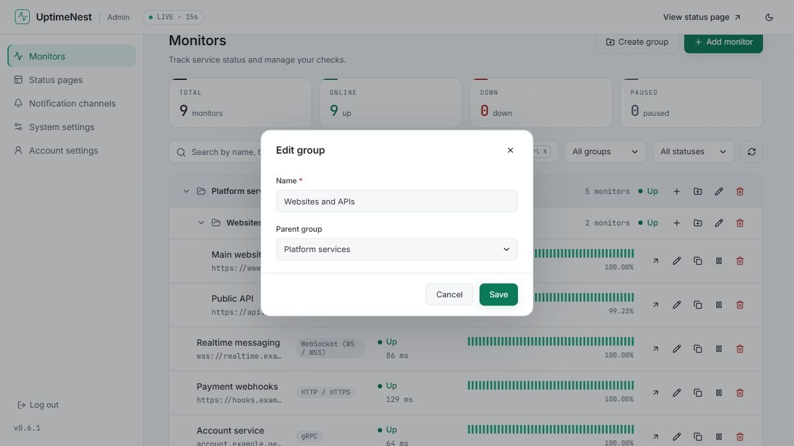
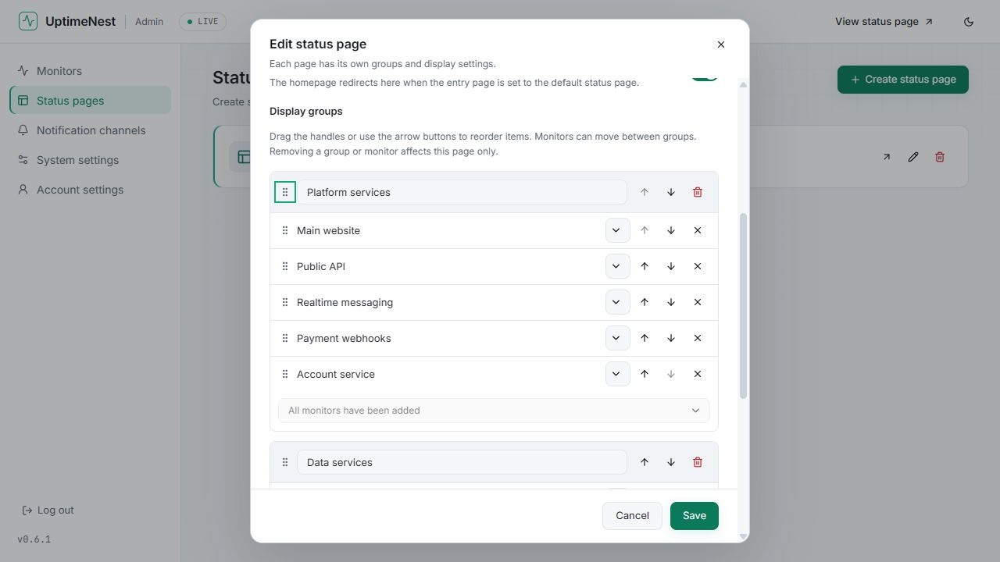
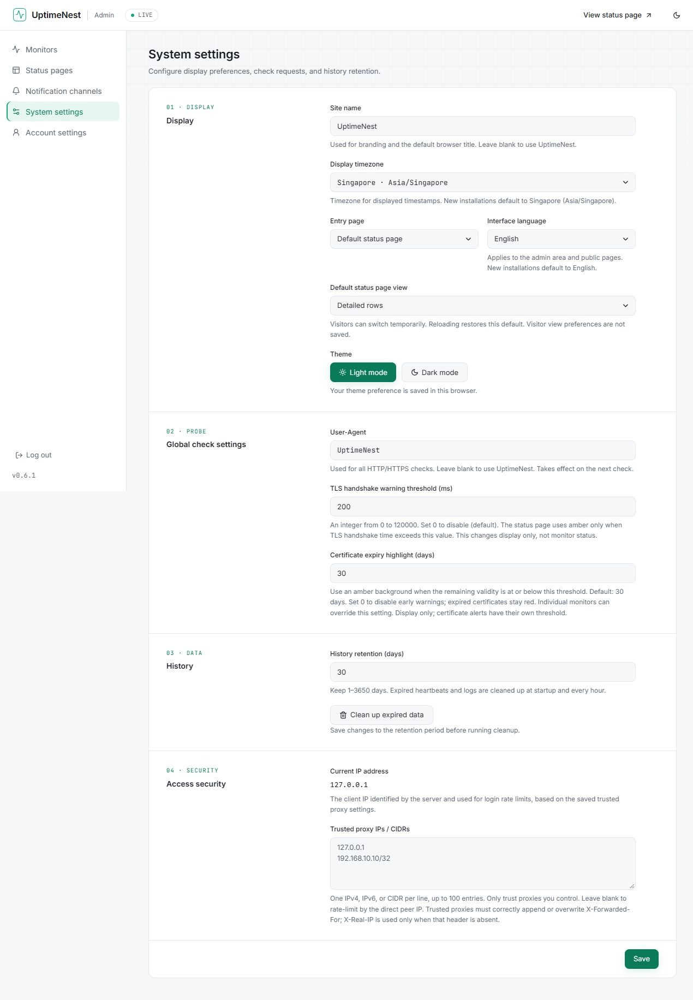

# Interface screenshots

[简体中文](screenshots.md) · English

[Project home](../README_en.md) · [Documentation](README_en.md) · [Usage guide](usage_en.md)

These screenshots show the actual English interface in an isolated demo. Domains, addresses, and statistics are illustrative and contain no real credentials. See the [usage guide](usage_en.md) for configuration and the [changelog](changelog_en.md) for version history.

[Status pages](#status-pages) · [Monitors and details](#monitors-and-details) · [Protocol configuration](#protocol-configuration) · [Groups and status panels](#groups-and-status-panels) · [System settings](#system-settings)

## Status pages

Detailed rows show service groups, recent heartbeats, availability, and connection details.

Cards emphasize availability and response time. Compact rows make it easier to browse multiple services on a phone.

<table>
  <tr><th width="75%">Dark card view</th><th width="25%">Mobile compact rows</th></tr>
  <tr>
    <td valign="top"></td>
    <td valign="top"></td>
  </tr>
</table>

## Monitors and details

The monitor list groups services by status and provides edit, duplicate, pause/resume, and detail actions.

The detail page shows availability, response time, and connection details. The latency chart has seven time ranges and marks failure periods.

## Protocol configuration

HTTP options include protocol mode, connection IP override, redirect limits, and accepted status codes.

WebSocket checks support handshake or Ping/Pong modes, Origin, subprotocols, connection IP, and request headers. Leave saved sensitive fields blank to retain them, or mark them for explicit removal.

## Groups and status panels

Admin groups support parent/child hierarchies. Edit group names and parents directly in the monitor list.

Status panels have independent display groups, monitor ordering, and cross-group moves.

## System settings

System settings include language, theme, default view, TLS and certificate warnings, history retention, and trusted proxies.

